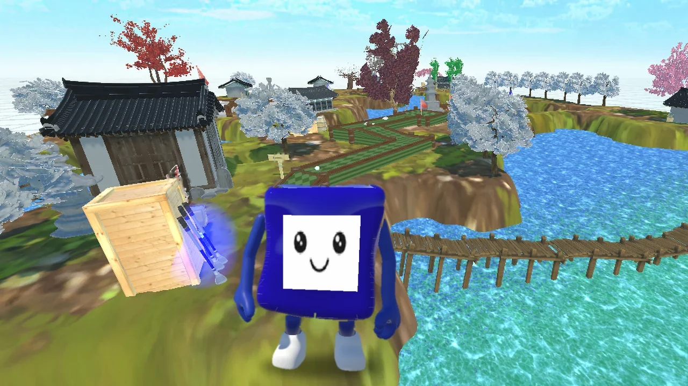
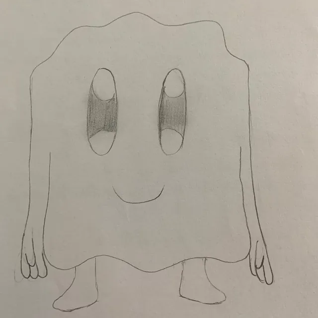
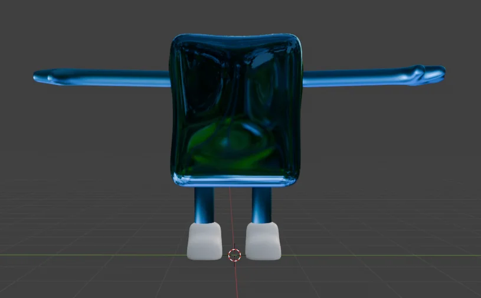
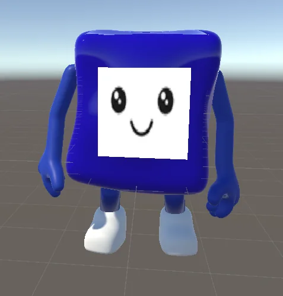
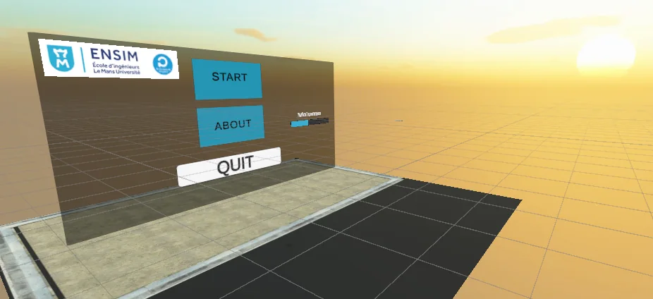

<a href="https://thibautplatet.com/en/projects/mystic-minigolf.html"><picture><source media="(prefers-color-scheme: dark)" srcset="https://raw.githubusercontent.com/ThibPltt/ThibPltt/main/assets/repos/Mystic_MiniGolf_VR-dark.svg"><source media="(prefers-color-scheme: light)" srcset="https://raw.githubusercontent.com/ThibPltt/ThibPltt/main/assets/repos/Mystic_MiniGolf_VR-light.svg"></picture></a>

# Mystic Minigolf

VR minigolf on an island of ancient temples, built as a pair.

| At a glance | |
|---|---|
| **Dates** | 2024 – 2025 |
| **Context** | virtual reality · built as a pair · ENSIM |
| **Technologies** | VR · Unity · C# · Blender |
| **Play it** | [v1.0 Windows build for PC VR](https://github.com/ThibPltt/Mystic_MiniGolf_VR/releases/latest) |
| **Case study** | [thibautplatet.com/en/projects/mystic-minigolf.html](https://thibautplatet.com/en/projects/mystic-minigolf.html) |
| **Report** | [Rapport Final Mystic MiniGolf.pdf](Rapport%20Final%20Mystic%20MiniGolf.pdf) (in French) |

## Problem

Build a virtual reality minigolf game in a peaceful world: an island surrounded by the sea, where a mascot welcomes players and shows them the moves.

## Role

Built as a pair. My part: the island, the menus and their interfaces, the C# scripts (score, menus, ball physics) and the mascot's animations.

## Decisions

Merge our two initial ideas into a single world; have an animated mascot demonstrate the swing; have the ball struck with a real movement, club in hand.

## Result

A game in two scenes: a start menu, then the island and its three courses, all playable to the end: you pick up a club, strike the ball and track your number of strokes.

## The game

A virtual reality minigolf game, on an island off the coast of Korea. The planet is covered by the seas: only the summits emerge, with their ancient temples. The player appears on an islet, crosses a bridge and reaches the main island, where a mascot is waiting to show how to play.

The concept merges our two initial ideas: minigolf courses in settings from around the world, and a futuristic world where small sea creatures have replaced humans.

Scenery, sounds and music: assets from the Unity Asset Store, including Korean temple models from the Korea Heritage Service.

## My contribution

- The island, in Unity: terrain, water, trees, buildings, bridges and props, sky, invisible walls at the edges.
- The menus and their interfaces: the start scene and the in-game menu.
- The C# scripts: score, menus, ball physics on contact with the club.
- In Blender: the mascot's animations and the rework of part of its skeleton.
- Importing the assets and tidying the project.

About 50 hours of development on my side. My teammate built the minigolf courses and modelled the mascot.

## Specification

| Expected | Answer |
|---|---|
| World | A peaceful island surrounded by the sea: temples, trees, traditional buildings, and ambient music from the moment you arrive. |
| Mascot | A creature made of "sea molecules", with arms and legs. It welcomes the player and repeats the move to make, in a loop. |
| Courses | Three courses, winding between the buildings. All three can be played to the end. |
| Moving | With the left joystick; you look around by really turning your head. |
| Grabbing the club | Aim at it, arm outstretched, and press the trigger. A blue halo shows it can be picked up; once released, it falls to the ground. |
| Striking | Aim at the ball with the club head and make a real swing. |
| Score | The number of strokes stays on screen, to make players want to try again with fewer strokes. |
| Menus | Start: play, credits, quit, volume. In game: volume and quit. |

## The mascot, from sketch to engine

Drawn and modelled by my teammate, the mascot is anything but humanoid: its one-block body holds both the head and the torso. The skeleton created with Mixamo therefore distorted it with every arm movement: I reworked part of its bones in Blender and worked on its animations (Blender and Mixamo). Its material did not carry over from Blender to Unity: it was recreated there.

<table>
  <tr>
    <td width="33%"></td>
    <td width="33%"></td>
    <td width="33%"></td>
  </tr>
  <tr>
    <td>The concept, on paper.</td>
    <td>The model in Blender, before the face.</td>
    <td>The mascot in Unity.</td>
  </tr>
</table>

## The start scene

The game opens on a floating menu, operated with the trigger.

The start scene: play, credits, quit and volume control.

## Method

- To locate a bug: change a value, comment out a line, test again.
- Ball physics: a script applies a force to the ball on contact with the club, tuned so that the stroke stays playable.

## Run it

- **Play:** download `Build_VR.zip` from the [latest release](https://github.com/ThibPltt/Mystic_MiniGolf_VR/releases/latest), unzip it, connect your headset to the PC (e.g. Meta Quest with Link) and run `Mystic_MiniGolf.exe`.
- **From the source:** open the project with Unity **2022.3.37f1** (XR Interaction Toolkit 2.5, OpenXR, Oculus XR plugin, XR Hands), open `Assets/Scenes/MainMenu.unity` and press **Play** with the headset connected. The scripts are in `Assets/Scripts/` (`GolfBallPhysics.cs`, `GolfClubGrip.cs`, `GolfClubHead.cs`, `GolfBallScore.cs`, `MenuController.cs`, `SoundManager.cs`…).

## Credits

Built as a pair with Gaïa Thomas at ENSIM (Interaction Personnes-Systèmes, 4th year). Scenery, sounds and music come from the Unity Asset Store, including Korean temple models from the Korea Heritage Service and the *Stylized General Modular Mini Golf* package by Aligned Games; they keep their own licences.
